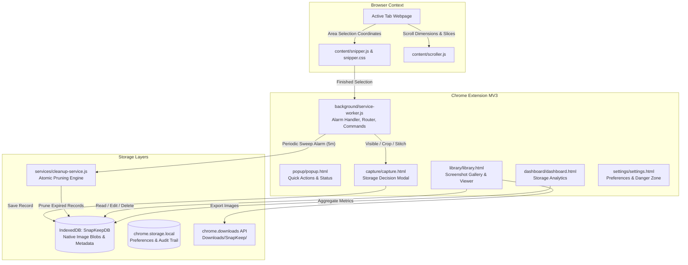
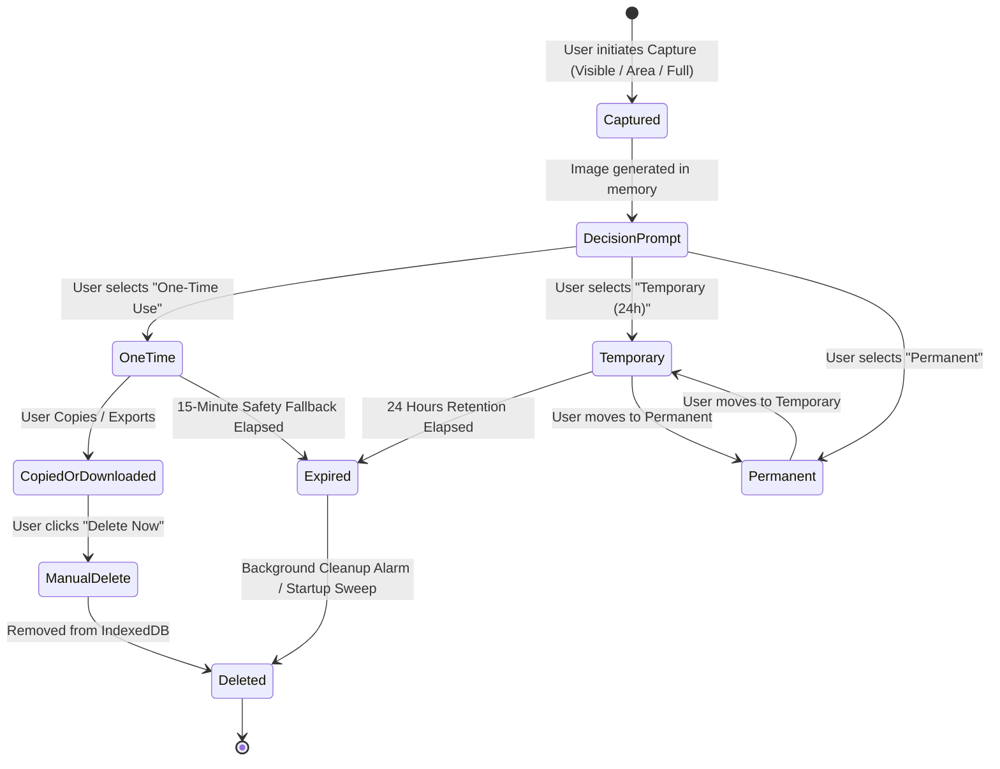
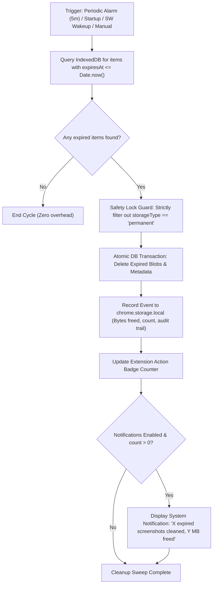

# SnapKeep — Smart Screenshot Manager Chrome Extension

[](https://developer.chrome.com/docs/extensions/mv3/intro/)
[](#privacy--security-guarantee)
[](#test-results--quality-assurance)

> *"Capture what you need. Keep what matters. Automatically delete what doesn't."*

---

## 1. Problem & Core Philosophy

Laptops accumulate thousands of stale screenshots over months and years. Most screenshots are needed only once or twice — to send an error message, share an invoice confirmation, or show a UI mock to a colleague. Yet, because users forget to clean them up, they sit on disk forever, devouring storage space and cluttering file finders.

**SnapKeep** solves this problem at the moment of capture:
Immediately after capturing any screen area, webpage, or element, SnapKeep presents a focused, friction-free decision interface:
- **Temporary (24 Hours)**: Automatically pruned after 24 hours.
- **One-Time Use**: Use immediately (copy to clipboard or export) with an automatic 15-minute fallback deletion.
- **Permanent**: Kept forever until explicitly deleted.

SnapKeep is built **100% local-first**. No analytics, no accounts, no servers, and zero data leaving your browser.

---

## 2. Installation Guide (For Any Browser User)

SnapKeep is a standalone, local-first Manifest V3 Chrome extension. Any user can install and run it in less than 60 seconds without needing to compile, build, or configure complex developer environments.

### Step 1: Get the Code
Choose either of these simple methods:

* **Option A: Clone with Git (Recommended)**
  ```bash
  git clone https://github.com/samiralam321/snapkeep.git
  ```
* **Option B: Download ZIP directly from GitHub**
  1. Click the green **`<> Code`** button at the top of this repository page.
  2. Click **Download ZIP**.
  3. Extract the downloaded `snapkeep-main.zip` folder on your computer.

---

### Step 2: Load the Extension in Google Chrome (or Edge / Brave)

1. Open **Google Chrome** (also fully compatible with Microsoft Edge, Brave, Opera, or any Chromium browser).
2. Open the Extensions management page:
   * **Chrome**: Type `chrome://extensions/` in your address bar and press Enter.
   * **Edge**: Type `edge://extensions/` in your address bar and press Enter.
   * **Brave**: Type `brave://extensions/` in your address bar and press Enter.
3. In the top-right corner, switch the **Developer mode** toggle to **ON**.
4. In the top-left toolbar, click the **Load unpacked** button.
5. In the file picker, navigate to and select the `snapkeep` directory you cloned or unzipped.
6. 🎉 **SnapKeep will immediately appear in your extensions list!**

---

### Step 3: Pin for One-Click Access

1. Click the **Extensions puzzle piece icon** in Chrome's top-right toolbar.
2. Find **SnapKeep** in the list and click the **Pin** icon next to it.
3. The SnapKeep icon will now stay pinned to your browser toolbar for instant access.

---

## 3. Key Features & Workflows

### A. Three Capture Methods
1. **Capture Visible Area**:
   - Captures the exact visible viewport of your active tab.
   - Shortcut: `Alt+Shift+V` (Mac: `Option+Shift+V`).
2. **Select Area (Interactive Snipper)**:
   - Injects a crosshair crop overlay directly into the webpage.
   - Click and drag to define the exact rectangular area with live pixel dimensions.
   - Press `Enter` or click **Capture** to snip, or `Esc` to cancel.
   - Shortcut: `Alt+Shift+S` (Mac: `Option+Shift+S`).
3. **Capture Full Webpage**:
   - Measures document dimensions and automatically scrolls through vertical slices.
   - Stitches chunks seamlessly into a single high-resolution image.
   - Restores the original scroll position when finished.
   - Shortcut: `Alt+Shift+F` (Mac: `Option+Shift+F`).

### B. Post-Capture Storage Decision Interface (`capture/capture.html`)
Immediately after capturing, a dedicated window appears with:
- **Instant Preview**: Dimensions, byte size, origin webpage domain.
- **Filename Editor**: Pre-filled with timestamped naming convention (e.g., `Screenshot_2026-11-01_14-30-22.png`).
- **Retention Choice**:
  - `Temporary — 24 Hours`: Automatic background deletion after 24 hours.
  - `One-Time Use`: Quick copy/export with a 15-minute safety fallback.
  - `Permanent — Keep Forever`: Saved indefinitely.
- **Quick Utilities**: One-click **Copy Image** directly to the OS clipboard, **Export File** to disk, or save to library.

### C. Screenshot Library (`library/library.html`)
- Dedicated full-page interface with categories: **All Snaps**, **Temporary (24h)**, **One-Time**, and **Permanent**.
- **Live Expiration Countdowns**: Active ticking countdowns on cards (e.g. `Expires in 18h 42m`, turning red under 5 minutes).
- **Search & Filter**: Real-time search across titles, filenames, and origin website URLs.
- **Sorting**: Newest first, oldest first, file size (desc/asc), and alphabetical by name.
- **Batch Management**: Multi-select cards, batch delete, or bulk-move between Temporary and Permanent tiers.
- **Full-Resolution Lightbox Modal**: Click any card thumbnail to inspect full-res images, rename, copy, or export.

### D. Storage Dashboard (`dashboard/dashboard.html`)
- **Accurate Storage Metrics**: Total screenshots, exact byte consumption calculated directly from IndexedDB Blobs.
- **Usage Breakdown Bar**: Visual representation of storage occupied by Temporary, One-Time, and Permanent captures.
- **Scheduled Deletion Box**: Live count of queued items and expired items waiting for the next cleanup cycle.
- **Audit Trail Log**: Historical table recording each cleanup run, count of deleted files, and exact megabytes freed.

### E. Settings & Customization (`settings/settings.html`)
- **Retention Lifespans**: Customize Temporary lifespan (12h, 24h, 48h, 7 days) and One-Time fallback (5m, 15m, 30m, 1h).
- **Appearance Themes**: Light, Dark, or System default.
- **Format Selection**: PNG (lossless) or JPEG (compact).
- **Automatic Cleanup Controls**: Toggle background sweeps and desktop notifications.
- **Danger Zone**: One-click Purge Temporary and Erase All Data with confirmation dialogs.

---

## 4. System Architecture

### Component Architecture & Data Flow



### Screenshot Lifecycle & Retention State Machine



### Automatic Cleanup Engine Flow



---

## 5. Storage Architecture & Safety Guarantees

### Two Distinct Storage Layers
1. **Internal Extension Storage (IndexedDB)**:
   - Full image files are stored as native binary `Blob` objects inside IndexedDB database `SnapKeepDB`.
   - Never loads large blobs into `chrome.storage.local` (which has a 5MB/10MB quota).
   - This database is 100% under SnapKeep's control, enabling true, reliable automatic deletion even if the user never downloads the file.
2. **Exported Disk Files (`chrome.downloads`)**:
   - When a user explicitly clicks **Export File**, the file is downloaded to `Downloads/SnapKeep/<Temporary | One-Time | Permanent>/`.
   - *Technical transparency*: Chrome extension sandboxing does not permit arbitrary filesystem deletion outside the browser's download record boundary. SnapKeep guarantees deletion from its internal database and informs the user accordingly.

### Expiration & Safety Lock Rules
- **Temporary Screenshots**: Expire exactly after their retention duration (default 24h).
- **One-Time Screenshots**: Expire after a 15-minute safety fallback.
- **Permanent Screenshots**: Protected by strict conditional safety locks:
  ```javascript
  if (item.storageType === STORAGE_TYPES.PERMANENT) {
    // Strictly ignored by automated cleanup sweeps
    continue;
  }
  ```
- **Automatic Sweep Triggers**:
  - Chrome Alarms API running periodically in the background.
  - Extension initialization on browser startup (`chrome.runtime.onStartup`).
  - Service worker wake-up events.
  - Opening the Library or Dashboard pages.
  - Manual "Clean Expired Now" button.

---

## 6. Permissions & Manifest V3 Justification

| Permission | Purpose |
| :--- | :--- |
| `activeTab` | Grants temporary access to capture the current tab and read tab title/URL for screenshot metadata. |
| `tabs` | Used to inspect active tab coordinates and open extension full pages (Library, Dashboard, Settings). |
| `scripting` | Dynamically injects `snipper.js` (area selector) and `scroller.js` (full page coordinator) on demand. |
| `storage` | Stores user configuration, retention preferences, theme state, and cleanup audit logs in `chrome.storage.local`. |
| `alarms` | Schedules persistent, power-efficient background cleanup sweeps without keeping service workers alive. |
| `downloads` | Exports screenshots into structured folders (`SnapKeep/Temporary/`, `SnapKeep/Permanent/`) on the user's laptop. |
| `notifications` | Displays optional system notification after automatic cleanup frees disk space. |
| `clipboardWrite` | Enables one-click "Copy Image" to system clipboard for instant pasting into Slack, Notion, Docs, etc. |
| `<all_urls>` (host) | Enables area snipping and scrolling coordination across any website visited by the user. |

---

## 7. Known Limitations & Edge Cases Handled

1. **Restricted Chrome Internal Pages**:
   - Webpages with schemes like `chrome://`, `chrome-extension://`, `devtools://`, `view-source:`, and the Chrome Web Store are protected by browser security policy.
   - SnapKeep detects these upfront and shows friendly, non-blocking guidance instead of crashing.
2. **Infinite Scrolling Webpages**:
   - Full-page capture caps scrolling at 16,000px to prevent browser canvas memory exhaustion on infinite social feeds.
3. **Clipboard Image Types**:
   - Standard Web Clipboard API requires `image/png`. SnapKeep automatically converts JPEG blobs to PNG prior to clipboard writes.

---

## 8. Test Results & Quality Assurance

SnapKeep includes automated unit tests running on Node.js v22's native test runner (`node:test` and `node:assert`).

To run tests locally:
```bash
npm test
# Or: node --test tests/*.test.js
```

### Verified Test Scenarios
```text
✔ SnapKeep Cleanup Engine Tests (4/4 passing)
  ✔ Prepare records with mixed expiration states
  ✔ getExpiredScreenshots strictly identifies only expired temporary and one-time captures
  ✔ deleteExpiredScreenshots prunes expired records and frees exact bytes
  ✔ Post-cleanup storage stats reflect accurate counts and sizes

✔ IndexedDB Database Service Tests (7/7 passing)
  ✔ Save Temporary screenshot with 24h expiration
  ✔ Save One-Time screenshot with 15m expiration
  ✔ Save Permanent screenshot with null expiration
  ✔ Retrieve screenshot by ID
  ✔ Update screenshot metadata (rename & tier change)
  ✔ Query Storage Statistics accurately
  ✔ Delete screenshot removes record from store

✔ Formatters Tests (9/9 passing)
  ✔ formatBytes handles zero, negative, and null values
  ✔ formatBytes formats KB, MB, and GB accurately
  ✔ formatCountdown handles permanent (null) expiration
  ✔ formatCountdown handles active future expiration
  ✔ formatCountdown marks urgent under 5 minutes
  ✔ formatCountdown marks expired in past
  ✔ getDomainFromUrl extracts clean hostname
  ✔ generateScreenshotName replaces tokens properly
  ✔ generateId produces unique non-empty identifiers

Total: 20 passed, 0 failed.
```

---

## 9. Privacy & Security Guarantee

- **Zero Tracking**: SnapKeep contains no third-party scripts, telemetry, or tracking pixels.
- **Zero Server Uploads**: Every screenshot is processed in local browser memory and saved to local IndexedDB.
- **Strict Content Security Policy**: No `eval()`, no remote code loading, no external CDN dependencies.
- **Open & Transparent**: Clean, modular vanilla JavaScript.
